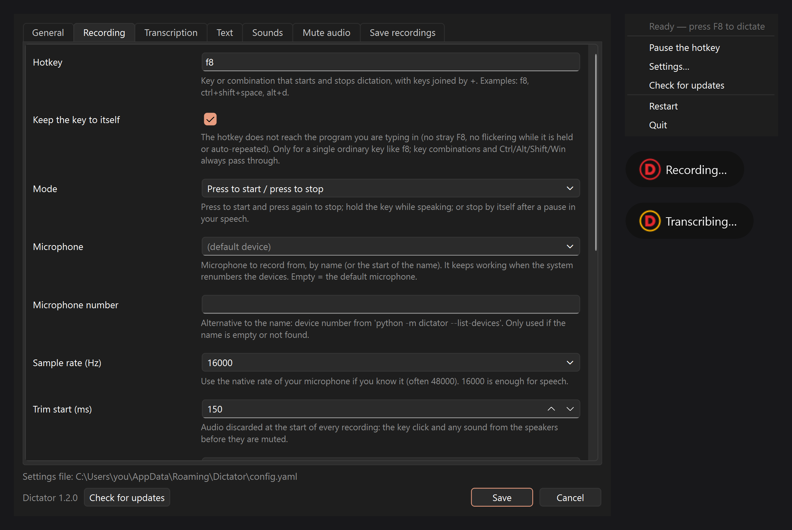

<p align="center"></p>

<h1 align="center">VoxKeyPaste</h1>

<p align="center"><b>Pulsa una tecla, habla y el texto aparece donde tengas el cursor.</b><br>
<a href="README.md">English</a> · Español</p>



VoxKeyPaste es una pequeña app de la bandeja del sistema para dictar en cualquier programa: un editor, un chat,
una terminal, un formulario. Graba mientras mantienes o activas una tecla, transcribe con
[Whisper](https://github.com/openai/whisper) (en tu propio ordenador o en cualquier servidor compatible con
OpenAI) y pega el texto de golpe.

## Qué hace

- **Tecla global** (`f8`, `ctrl+shift+space`…) en tres modos: pulsar para empezar / pulsar para parar,
  mantener pulsada para hablar, o parar sola tras una pausa.
- **Transcripción local o en servidor**: [faster-whisper](https://github.com/SYSTRAN/faster-whisper) en tu
  CPU/GPU, OpenAI o tu propio servidor compatible con OpenAI (p. ej. [Speaches](https://github.com/speaches-ai/speaches)).
- **Pega todo el texto de golpe** por el portapapeles (y devuelve lo que hubiera), o lo teclea tecla a tecla.
- **Sonidos de inicio y fin** para saber cuándo hablar; el de fin suena en el momento de pulsar, sin esperar a
  la transcripción.
- **Calla el ordenador mientras dictas** (Windows) para que el micrófono no recoja música ni vídeos: silencia la
  salida del sistema y/o canales de Voicemeeter, y los devuelve en cuanto paras, aunque la app se haya cerrado a
  medias. Nunca toca el volumen de cada programa.
- **No se come palabras**: recorta el clic de la tecla al principio y sigue grabando unos cientos de
  milisegundos tras parar, para no perder la última sílaba.
- **Micrófono por nombre**: sigue funcionando aunque Windows renumere los dispositivos de audio al reiniciar o
  al enchufar algo por USB.
- **Diccionario de correcciones**: un fichero de texto con líneas `mal=bien` para las palabras que Whisper
  entiende mal una y otra vez.
- **Guarda tus grabaciones** (opcional): cada dictado en FLAC + texto, por ejemplo para entrenar una voz, con
  un comando opcional para mandarlas a otra máquina.
- **Interfaz en 15 idiomas**: English, Español, Português, Français, Deutsch, Italiano, Nederlands, Polski,
  Русский, Українська, 简体中文, 日本語, 한국어, ไทย, हिन्दी.
- Icono de bandeja que enseña el estado (aro rojo = grabando, ámbar = transcribiendo), **Reiniciar** desde el
  menú y una sola instancia a la vez.

## Instalación

VoxKeyPaste está hecho y probado en **Windows 10/11**. También funciona en Linux con sesión X11, pero ahí
no se prueba habitualmente. Necesitas **Python 3.11** y Git.

```powershell
git clone https://github.com/javimentallab/VoxKeyPaste.git
cd VoxKeyPaste
py -3.11 -m venv .venv
.venv\Scripts\python -m pip install -r requirements.txt
.venv\Scripts\pythonw -m voxkeypaste
```

En Linux: `python3.11 -m venv .venv`, `.venv/bin/pip install -r requirements.txt` y
`.venv/bin/python -m voxkeypaste`.

La primera vez se abre la ventana de ajustes. Con lo predeterminado usa el modelo local `base`, que se
descarga una sola vez (unos 150 MB). Elige micrófono, idioma y tecla, y guarda.

El motor local funciona con el procesador. Para usar una tarjeta gráfica NVIDIA hay que instalar las
librerías CUDA 12 y cuDNN 9 [como explica faster-whisper](https://github.com/SYSTRAN/faster-whisper#gpu); si
no están, VoxKeyPaste lo detecta y sigue con el procesador.

### Arrancar con Windows

```powershell
powershell -ExecutionPolicy Bypass -File tools\windows\install-autostart.ps1
```

Añade `-Elevated` (desde un PowerShell de administrador) si también quieres dictar en programas abiertos como
administrador: Windows no deja que un programa normal escriba en uno elevado. `-Remove` borra la tarea.

## Ajustes

Todo está en la ventana de ajustes (icono de la bandeja → **Ajustes…**, o doble clic en el icono). Cada opción
lleva su explicación debajo. Los ajustes se guardan en un fichero YAML fuera de la carpeta del programa:

| Sistema | Fichero |
|---------|---------|
| Windows | `%APPDATA%\VoxKeyPaste\config.yaml` |
| Linux   | `~/.config/voxkeypaste/config.yaml` |

Para usar otro fichero: `python -m voxkeypaste --config ruta\al\config.yaml`.
Para ver los dispositivos de audio: `python -m voxkeypaste --list-devices`.

### Con tu propio servidor de Whisper

Pon **Transcripción → Motor** en *Servidor API*, **URL del servidor** con la de tu servidor (acabada en `/v1`,
p. ej. `http://192.168.1.10:8000/v1`) y **Modelo del servidor** con el que sirva (p. ej. `large-v3`). La clave
puede quedarse vacía: la mayoría de servidores propios la ignoran.

### Diccionario de correcciones

Crea un fichero de texto así y elígelo en **Texto → Fichero de correcciones**:

```text
# mal=bien, uno por línea
box quei peist=VoxKeyPaste
git hub=GitHub
```

Solo palabras enteras, sin distinguir mayúsculas, y respeta la mayúscula inicial. Se vuelve a leer en cada
dictado, así que puedes editarlo con la app en marcha.

### Mandar las grabaciones a otro sitio

Con **Guardar grabaciones** activado, se ejecuta un comando opcional por cada clip. `{audio}` y `{text}` se
cambian por las rutas de los ficheros; no pasa por ninguna shell. Ejemplo:

```text
scp -q -B -o ConnectTimeout=5 {audio} {text} yo@miservidor:/datos/clips/
```

Si el comando sale bien se borran los ficheros locales; si falla, se quedan y se mandan tras el siguiente
dictado.

## Si algo falla

- **No escribe en algunas ventanas**: están abiertas como administrador. Arranca VoxKeyPaste elevado
  (`install-autostart.ps1 -Elevated`).
- **Graba silencio**: revisa el nombre del micrófono en **Grabación → Micrófono**; con `--list-devices` ves los
  nombres exactos.
- **Registro**: arrancada sin consola (`pythonw`), la app escribe `voxkeypaste.log` junto a `config.yaml`.
- **Linux**: la tecla global y el tecleo simulado necesitan una sesión X11 (Wayland los bloquea).

## Desarrollo

```powershell
.venv\Scripts\python -m pip install -r requirements-dev.txt
.venv\Scripts\python -m pytest
```

`tools/make_sounds.py` vuelve a generar los sonidos (sintetizados, sin audio de terceros),
`tools/make_icons.py` los iconos y `tools/make_screenshots.py` las imágenes de este README.
Las traducciones están en `voxkeypaste/locales/<idioma>.json`; un test comprueba que no falte ninguna clave.

## Créditos

VoxKeyPaste nació inspirado por [WhisperWriter](https://github.com/savbell/whisper-writer), de savbell. Es un
programa independiente escrito desde cero y no contiene código suyo. Los componentes de terceros y sus
licencias están en [NOTICE](NOTICE).

## Licencia

[MIT](LICENSE)
