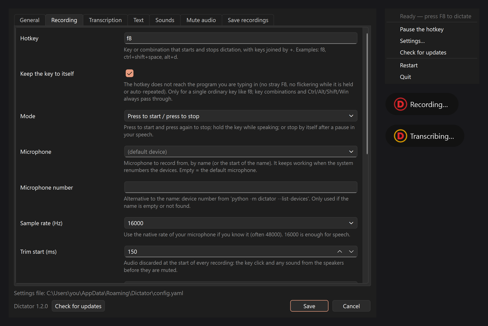

<p align="center"></p>

<h1 align="center">VoxKeyPaste</h1>

<p align="center"><b>Press a key, speak, and the text appears wherever your cursor is.</b><br>
English · <a href="README.es.md">Español</a></p>



VoxKeyPaste is a small tray app for dictating into any program: an editor, a chat, a terminal, a form.
It records while you hold or toggle a hotkey, transcribes with [Whisper](https://github.com/openai/whisper)
(on your own computer or on any OpenAI-compatible server) and pastes the text in one go.

## Features

- **Global hotkey** (`f8`, `ctrl+shift+space`…) in three modes: press to start / press to stop, hold to talk,
  or stop by itself after a pause. In any mode, if nobody speaks for 15 seconds the recording ends by itself,
  so a press you forgot to follow with a second one does not leave the computer muted.
- **Local or server transcription**: [faster-whisper](https://github.com/SYSTRAN/faster-whisper) on your CPU/GPU,
  OpenAI, or your own OpenAI-compatible server (e.g. [Speaches](https://github.com/speaches-ai/speaches)).
- **Pastes the whole text at once** through the clipboard (and puts back what you had there), or types it key by key.
- **Start and stop sounds** so you know when to speak — the stop sound plays the moment you press the key,
  without waiting for the transcription.
- **Silences the computer while you dictate** (Windows) so the microphone does not pick up music or videos:
  mutes the system output and/or Voicemeeter strips, and unmutes them the moment you stop — even after a crash.
  Programs' own volumes are never touched.
- **Doesn't cut your words**: trims the key click at the start and keeps recording a few hundred milliseconds
  after you stop, so the last syllable is not lost.
- **Robust microphone selection by name**: keeps working when Windows renumbers the audio devices
  after a reboot or when you plug in USB devices.
- **Correction dictionary**: a plain text file of `wrong=right` lines for words Whisper keeps mishearing.
- **Keep your recordings** (optional): every dictation saved as FLAC + text, e.g. to train a voice model,
  with an optional command to send them to another machine.
- **Interface in 15 languages**: English, Español, Português, Français, Deutsch, Italiano, Nederlands, Polski,
  Русский, Українська, 简体中文, 日本語, 한국어, ไทย, हिन्दी.
- Tray icon that shows the state (red ring = recording, amber = transcribing), **Restart** from the tray menu,
  and only one instance at a time.

## Install

VoxKeyPaste is made and tested on **Windows 10/11**. It also runs on Linux with an X11 session, but that
is not tested regularly. You need **Python 3.11** and Git.

```powershell
git clone https://github.com/javimentallab/VoxKeyPaste.git
cd VoxKeyPaste
py -3.11 -m venv .venv
.venv\Scripts\python -m pip install -r requirements.txt
.venv\Scripts\pythonw -m voxkeypaste
```

On Linux use `python3.11 -m venv .venv`, `.venv/bin/pip install -r requirements.txt` and
`.venv/bin/python -m voxkeypaste`.

The first time, the settings window opens. With the defaults it uses the local `base` model,
which is downloaded once (about 150 MB). Pick your microphone, your language and a hotkey, and save.

The local engine runs on the processor. To use an NVIDIA graphics card instead, install the CUDA 12
and cuDNN 9 libraries [as faster-whisper explains](https://github.com/SYSTRAN/faster-whisper#gpu); if they
are missing, VoxKeyPaste notices it and stays on the processor.

### Start with Windows

```powershell
powershell -ExecutionPolicy Bypass -File tools\windows\install-autostart.ps1
```

Add `-Elevated` (from an administrator PowerShell) if you also want to dictate into programs running as
administrator: Windows does not let a normal program type into an elevated one. `-Remove` deletes the task.

## Settings

Everything is in the settings window (tray icon → **Settings…**, or double-click the icon). Each option has
its explanation underneath. The settings are stored in a YAML file outside the program folder:

| System  | File |
|---------|------|
| Windows | `%APPDATA%\VoxKeyPaste\config.yaml` |
| Linux   | `~/.config/voxkeypaste/config.yaml` |

Use another file with `python -m voxkeypaste --config path\to\config.yaml`.
List the audio devices with `python -m voxkeypaste --list-devices`.

### Using your own Whisper server

Set **Transcription → Engine** to *API server*, **Server URL** to your server (ending in `/v1`, e.g.
`http://192.168.1.10:8000/v1`) and **Server model** to the model it serves (e.g. `large-v3`). The API key can
stay empty: most self-hosted servers ignore it.

### Correction dictionary

Create a text file like this and select it in **Text → Corrections file**:

```text
# wrong=right, one per line
voks key paste=VoxKeyPaste
git hub=GitHub
```

Whole words only, case-insensitive, and the capital of the first letter is kept. The file is read again on
every dictation, so you can edit it while the app runs.

### Sending recordings somewhere

With **Save recordings** enabled, an optional command runs for each clip. `{audio}` and `{text}` are replaced
by the file paths; no shell is involved. Example:

```text
scp -q -B -o ConnectTimeout=5 {audio} {text} me@myserver:/data/clips/
```

If the command succeeds the local files are deleted; if it fails they stay and are sent after the next
dictation.

## Troubleshooting

- **Nothing is typed into some windows** — they run as administrator. Start VoxKeyPaste elevated
  (`install-autostart.ps1 -Elevated`).
- **It records silence** — check the microphone name in **Recording → Microphone**; run
  `--list-devices` to see the exact names.
- **Logs** — started without a console (`pythonw`), the app writes `voxkeypaste.log` next to `config.yaml`.
- **Linux**: global hotkeys and simulated typing need an X11 session (Wayland blocks them).

## Development

```powershell
.venv\Scripts\python -m pip install -r requirements-dev.txt
.venv\Scripts\python -m pytest
```

`tools/make_sounds.py` regenerates the built-in sounds (synthesised, no third-party audio),
`tools/make_icons.py` the icons and `tools/make_screenshots.py` the pictures of this README.
Translations live in `voxkeypaste/locales/<language>.json`; a test checks that every language has every key.

## Credits

VoxKeyPaste was inspired by [WhisperWriter](https://github.com/savbell/whisper-writer) by savbell. It is an
independent program written from scratch and contains no code from it. Third-party components and their
licences are listed in [NOTICE](NOTICE).

## Contributing

See [CONTRIBUTING](CONTRIBUTING.md). To report a security problem privately, see [SECURITY](SECURITY.md).

## License

[MIT](LICENSE)
